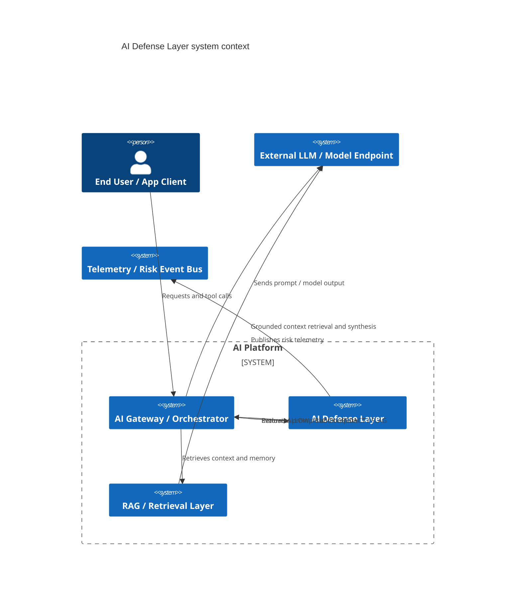
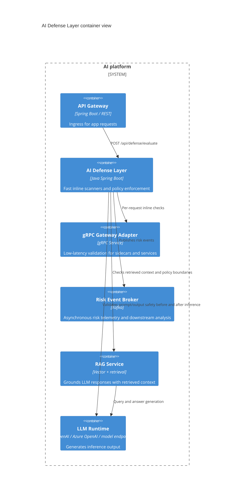
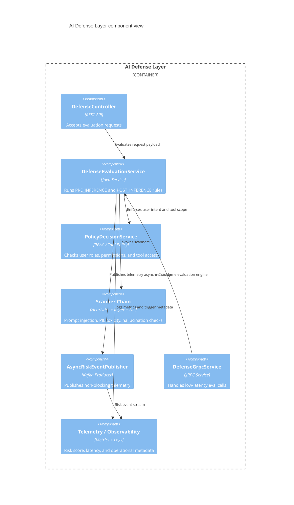
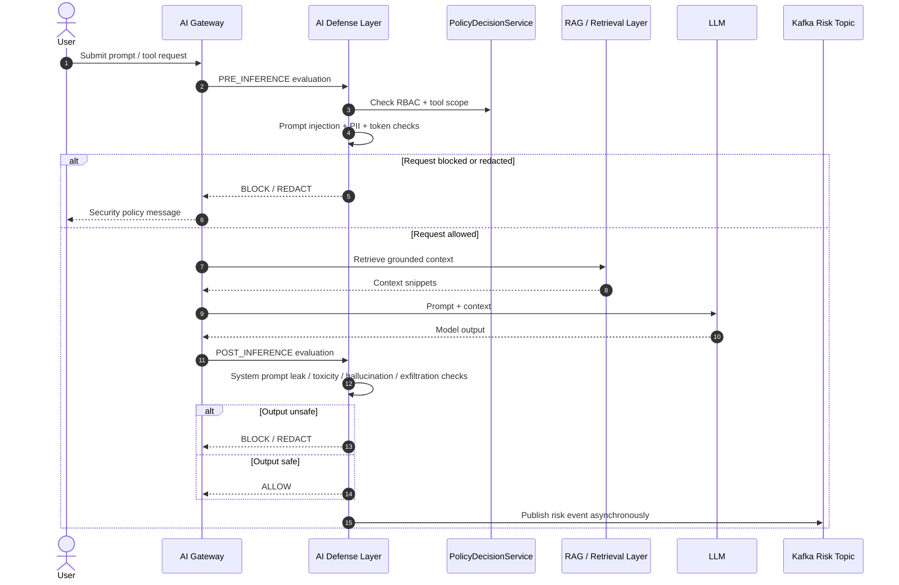
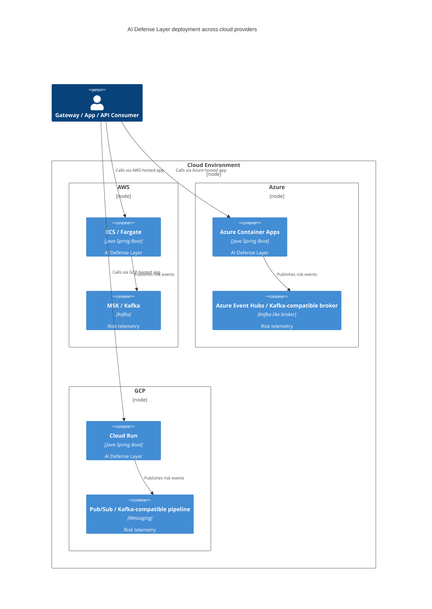

# AI Defense Layer

This Spring Boot microservice provides a defense-in-depth layer for AI applications.

## Features

- Pre-inference prompt injection and PII detection
- Post-inference output safety scanning
- Structured decision contract for gateways and orchestrators
- Async Kafka event publishing for telemetry and security analytics
- gRPC service for low-latency inline validation
- Role- and permission-aware policy checks

## Quick Start

```bash
mvn clean package
java -jar target/ai-defense-layer-0.0.1-SNAPSHOT.jar
```

## Mermaid C4 Diagrams

### System Context



### Container Diagram



### Component Diagram



### Sequence Diagram: Pre- and Post-Inference Defense Flow



### Deployment Diagram: AWS / Azure / GCP



## Docker

```bash
docker build -t ai-defense-layer .
docker run -p 8080:8080 -p 9090:9090 \
  -e SERVER_PORT=8080 \
  -e GRPC_SERVER_PORT=9090 \
  -e KAFKA_BOOTSTRAP_SERVERS=localhost:9092 \
  -e OPENAI_API_KEY=your-key \
  ai-defense-layer
```

## Deployment Notes

Example infrastructure templates are included under:

- `deploy/aws/task-definition.json`
- `deploy/azure/container-app.yaml`
- `deploy/gcp/cloudrun.yaml`

These are starter templates and must be tailored to your actual cloud accounts, infrastructure, Kafka brokers, and secret management configuration.
